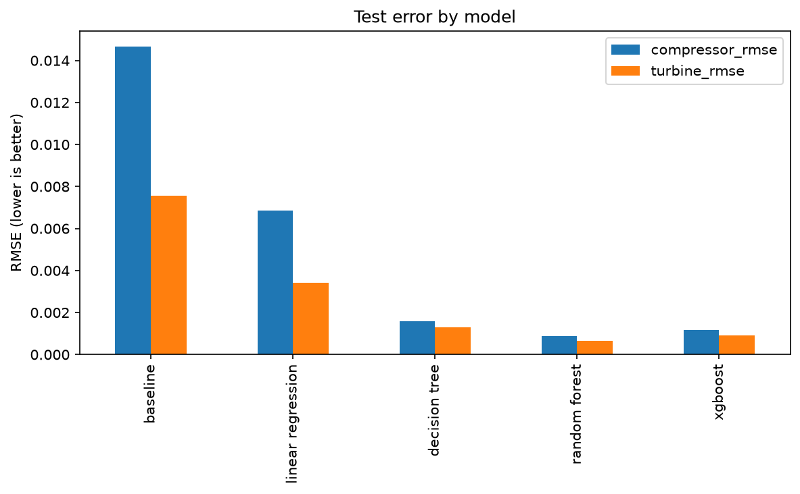
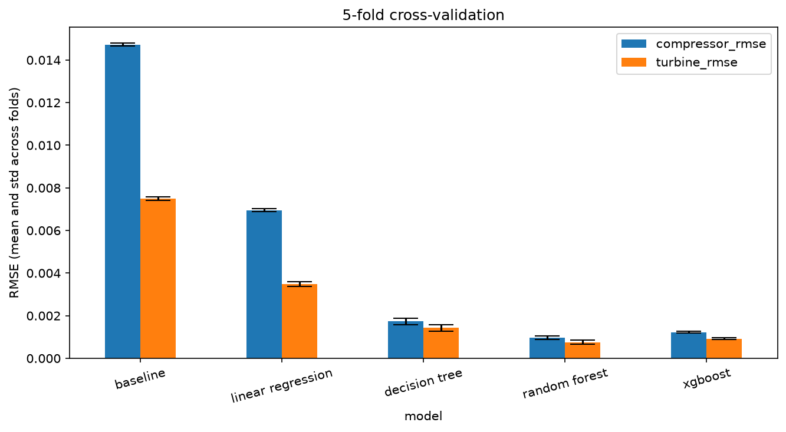
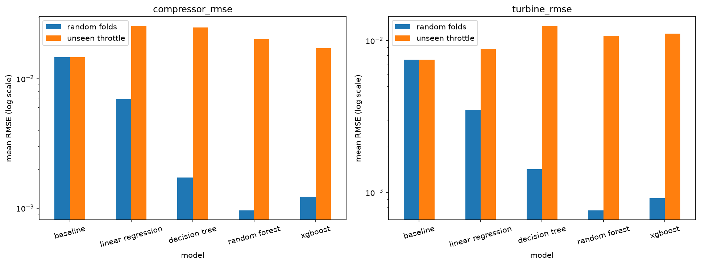
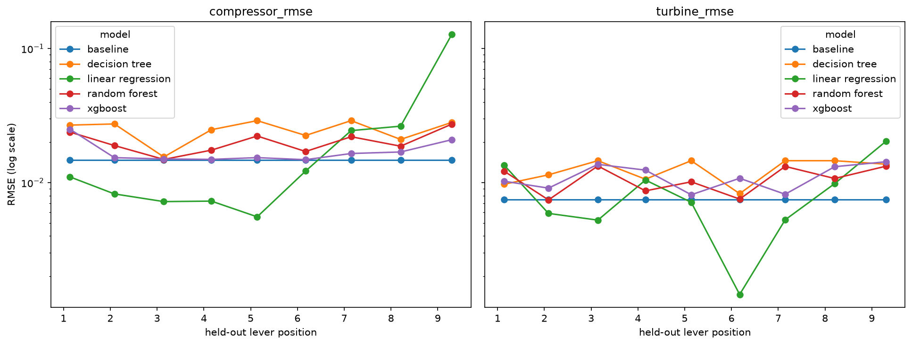
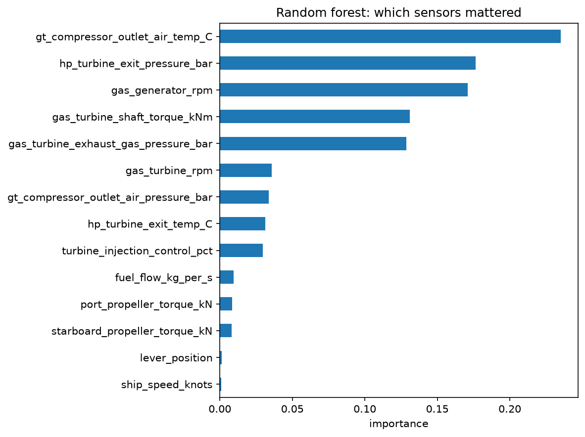

# Predicting Gas Turbine Wear from Sensor Data: Write-up

## 1. Summary
This project predicts how worn a naval gas turbine's compressor and turbine are based on 14 sensor readings. On a random 80/20 split, the best model, a random forest, reached a test RMSE of 0.00087 (compressor) and 0.00065 (turbine), which is about 94% and 91% lower than a baseline that always guesses the average. Wear can't be measured on a running engine, so a data-driven estimate could support condition-based maintenance.

However, when I held out an entire throttle setting during model validation, none of the tree-based models beat the baseline on average. This means that the models work well at throttle settings they have seen examples of, but this project does not show that they work at new ones.

## 2. Dataset and cleaning
The dataset has 11,934 rows, 16 sensor columns, and 2 targets, being the compressor and turbine decay state (1.00 healthy, lower is more worn). It comes from a simulator of a naval propulsion plant, available from the UCI repository. I used a CSV copy of the same dataset downloaded from Kaggle. Cleaning consisted of 2 steps, a check that stops the run if any values are missing (none were) and the removal of two constant columns (compressor inlet air temperature and pressure), leaving 14 inputs.

The rows form a complete grid with 9 throttle settings x 51 compressor decay values (0.95 to 1.00) x 26 turbine decay values (0.975 to 1.00), which makes 11,934 rows.

## 3. EDA and important findings

- **Throttle dominates the sensor readings.** Nearly all of the sensors correlate 0.9 to 1.0 with each other because the throttle setting (9 lever positions) drives the whole engine. The two wear columns show about 0 correlation with everything in this view.
- **Wear is visible once throttle is held fixed.** At the highest lever position, compressor outlet air temperature tracked compressor wear with a correlation of about -0.98, and gas turbine shaft torque tracked turbine wear at about +0.92.
- **Different sensors respond to different wear types.** Compressor outlet air temperature, gas generator RPM and HP turbine exit temperature move with compressor wear, while turbine wear only spreads them out. Shaft torque is the clearest signal for turbine wear. Exhaust gas pressure moves in four discrete steps with compressor wear and not with turbine wear. Compressor outlet pressure responds to both types, in opposite directions.

## 4. Preprocessing
The data was split 80/20 at random (using seed 42) into training and test sets. I did not do any scaling or encoding since all of the columns were numeric and the tree-based models didn't need scaling. The lever position was kept as an input so the models can compare readings at the same throttle setting. No new features were created.

## 5. Modeling strategy
Five models were chosen in advance, being a baseline that predicts the training average (the floor), linear regression (simple), a decision tree (flexible but has high variance), a random forest (100 averaged trees, which keeps the flexibility and reduces variance), and XGBoost (trees built one after another, each correcting the last one's errors). All of them use their default settings with no hyperparameter tuning. Both targets are predicted together.

## 6. Model comparison

| Model | Compressor RMSE | Turbine RMSE | Compressor MAE | Turbine MAE | Compressor improvement | Turbine improvement |
| :--- | ---: | ---: | ---: | ---: | ---: | ---: |
| Baseline (mean) | 0.01467 | 0.00755 | 0.01272 | 0.00654 | 0% | 0% |
| Linear regression | 0.00687 | 0.00343 | 0.00568 | 0.00267 | 53.1% | 54.5% |
| Decision tree | 0.00160 | 0.00129 | 0.00112 | 0.00080 | 89.1% | 82.9% |
| **Random forest** | **0.00087** | **0.00065** | **0.00047** | **0.00033** | **94.1%** | **91.5%** |
| XGBoost | 0.00116 | 0.00091 | 0.00087 | 0.00063 | 92.1% | 87.9% |

*The test set consisted of 2,387 rows (20%) that were held out before training. A model is better if its RMSE (error) is lower in comparison with the baseline.*

The ranking is the same under RMSE and MAE. Linear regression halves the baseline error but can't follow the curved relationships, such as how fuel flow rises faster at higher speeds. The random forest roughly halves the single tree's error.

The forest is also the slowest model. In model validation, it took about 0.81 s to fit, compared with 0.16 s for the tree and 0.28 s for XGBoost. It took 0.075 s to predict, compared with 0.002 s for the tree and 0.008 s for XGBoost. The forest is about 5x slower to train and about 35x slower to predict than the tree.

## 7. Validation with random folds and unseen throttle settings
A single split can be lucky, so I checked the results two ways. I did 5-fold cross-validation with random folds, where every fold's test rows were mixed in with training rows from all throttle settings.

I also did validation by leaving one throttle out. This was done by holding out all rows of one throttle setting, training on the other eight, and repeating this for each of the 9 settings. This second test asks whether a model can handle an operating condition it has never seen.

Random folds agree with the single split. The ranking is unchanged, and the spread across folds is small (for example, forest compressor RMSE 0.00096 +/- 0.00009), so the earlier result was not a lucky seed.

| Model | Compressor RMSE, random folds | Turbine RMSE, random folds | Compressor RMSE, unseen throttle | Turbine RMSE, unseen throttle |
| :--- | ---: | ---: | ---: | ---: |
| Baseline (mean) | 0.01472 +/- 0.00007 | 0.00750 +/- 0.00008 | 0.01472 +/- 0.00000 | 0.00750 +/- 0.00000 |
| Linear regression | 0.00695 +/- 0.00007 | 0.00348 +/- 0.00011 | 0.02556 +/- 0.03902 | 0.00879 +/- 0.00558 |
| Decision tree | 0.00173 +/- 0.00015 | 0.00142 +/- 0.00015 | 0.02493 +/- 0.00451 | 0.01245 +/- 0.00247 |
| Random forest | 0.00096 +/- 0.00009 | 0.00076 +/- 0.00009 | 0.02028 +/- 0.00388 | 0.01072 +/- 0.00242 |
| XGBoost | 0.00123 +/- 0.00005 | 0.00092 +/- 0.00005 | 0.01721 +/- 0.00350 | 0.01111 +/- 0.00237 |

Holding out a throttle setting shows something very important though. The random forest's error rises from 0.00096 to 0.0203 for the compressor, about 21x higher, and ends up about 38% worse than the baseline. For the turbine it is about 43% worse than the baseline. It beat the baseline on 0 of 9 throttle settings for the compressor and 1 of 9 for the turbine.

The decision tree and XGBoost also failed to beat the baseline on any throttle setting for either target. XGBoost came closest on the compressor (around 17% worse than the baseline).

Linear regression was the only model to beat the baseline on most unseen settings (6 of 9 for the compressor, 5 of 9 for the turbine), but it is very unstable. Its error on the highest throttle setting is far above everything else, which is why its standard deviation is so large. Because of that one setting, its average error is still above the baseline's (about 74% worse for the compressor and 17% worse for the turbine).

## 8. Error analysis

Most points sit tightly on the red line for both targets, matching the low RMSE.

The biggest misses, however, are at the ends of the range. At the end with the least wear (1.00), predictions fall slightly below the truth, and at the worn end (0.95 for the compressor, 0.975 for the turbine) they sit slightly above it.

Tree models tend to average over the training rows, so some error at the extremes was expected.

## 9. Feature importance

Based on the horizontal bar chart, five sensors make up roughly 84% of the total: the compressor outlet air temperature (about 0.24), HP turbine exit pressure (about 0.18), gas generator RPM (about 0.17), gas turbine shaft torque (about 0.13), and exhaust gas pressure (about 0.13).

This matches with section 3, where compressor outlet air temperature and shaft torque were the two sensors that tracked wear once throttle was held fixed, and exhaust gas pressure was the one that stepped with compressor wear.

However, the importance of each sensor is combined across both targets, so we don't know which sensor matters for which wear type. Near-duplicate sensors also share importance between them (the port and starboard propeller torques have a correlation of 1.00, and so do lever position and ship speed), so individual bars might understate how useful they are. Also, this importance describes what the forest used on a random split, which may not be the sensors that work best on new throttle settings.

## 10. Takeaways
- Wear can be seen in the sensors, but only after you account for the throttle setting.

- A random forest can learn the pattern for wear. On a random split, its wear estimates were off by about 0.001 on a scale where wear spans 0.05 for the compressor and 0.025 for the turbine. Linear regression is not good enough, but XGBoost is close to the forest. XGBoost also trained about 3x faster and predicted 9x faster than the forest, which can be important if dealing with larger amounts of data.

- Those scores only hold for throttle settings the model has seen. When a whole throttle setting was held out, the tree-based models were worse than just guessing the average.

- In this simulated data, my approach works for an engine running at settings it was trained on, but it did not perform well on new operating conditions.

## 11. Limitations and future work
**Limitations**

- The data is simulated, so real sensor noise, drift, failures, and other realistic errors are not represented.

- The rows form a complete grid, so on a random split every test row has near-identical neighbors (one decay step away) in the training set. That makes the random-split scores optimistic.

- There are only 9 throttle settings, so the leave-one-out test is coarse, and the end settings (1 and 9) are extrapolation rather than interpolation.

- All models use default settings with no tuning. Feature importance is combined across targets and affected by correlated sensors.

**Next steps**

- Try different model hyperparameters, and evaluate each one by how well it predicts a throttle setting the model hasn't seen.

- Add new columns that compare sensors to each other (for example, one reading divided by another), to see if creating ratios helps the models get thrown off less by throttle changes.

## References
Coraddu, A., Oneto, L., Ghio, A., Savio, S., Anguita, D., & Figari, M. (2014). Condition Based Maintenance of Naval Propulsion Plants [Dataset]. UCI Machine Learning Repository. https://doi.org/10.24432/C5K31K.

Coraddu, A., Oneto, L., Ghio, A., Savio, S., Anguita, D., & Figari, M. (2016). Machine learning approaches for improving condition-based maintenance of naval propulsion plants. Proceedings of the Institution of Mechanical Engineers, Part M: Journal of Engineering for the Maritime Environment, 230(1), 136-153. https://doi.org/10.1177/1475090214540874

Kaggle copy of the dataset: Predictive Maintenance: Naval Vessel Condition, Kaggle. https://www.kaggle.com/datasets/thedevastator/improving-naval-vessel-condition-through-machine/data
