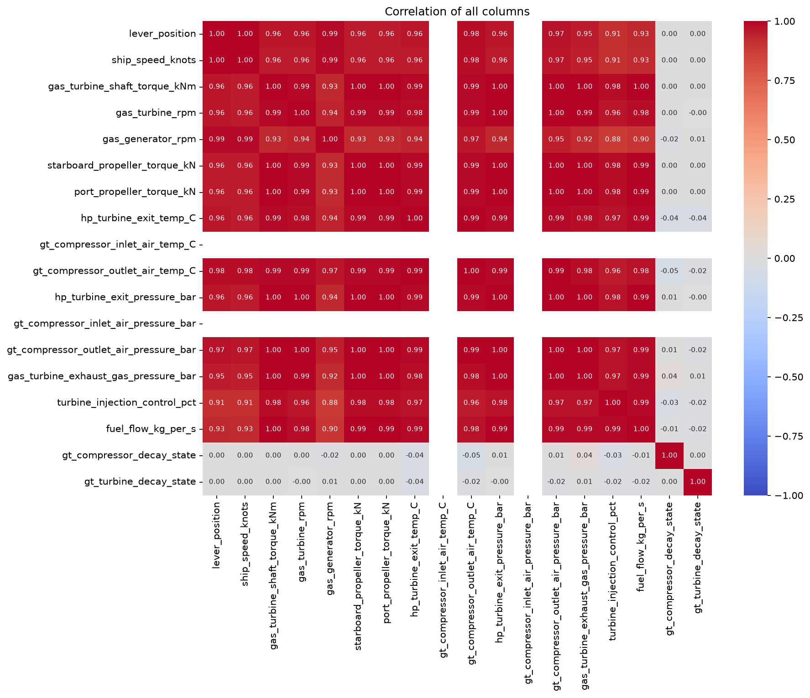
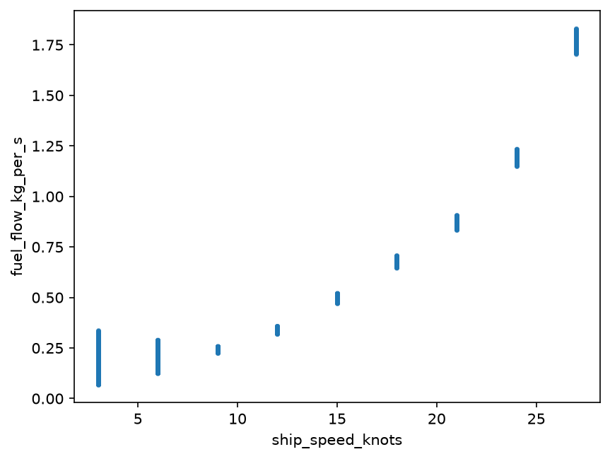
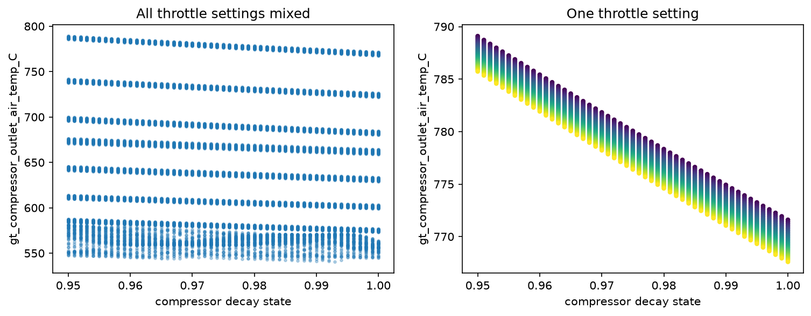
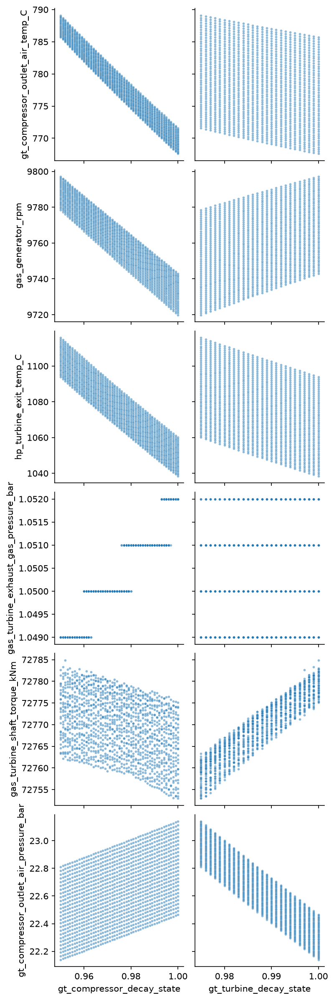
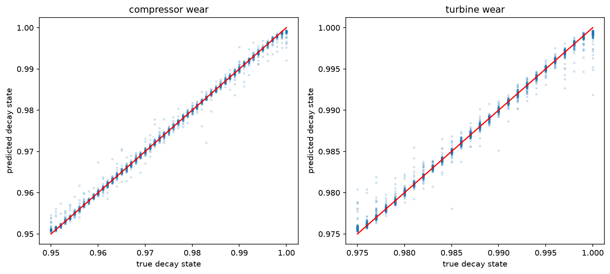

# Predicting Gas Turbine Wear from Sensor Data: Write-up

## 1. Summary
This project predicts how worn a naval gas turbine's compressor and turbine are based off of 14 sensor readings. The best model, a random forest, reached a test RMSE of 0.00087 (compressor) and 0.00065 (turbine), which is about 94% and 91% lower than a baseline that always guesses the average. Wear can't be measured on a running engine, so a data-driven estimate supports condition-based maintenance.

## 2. Dataset and cleaning
The dataset has 11,934 rows, 16 sensor columns, and 2 targets, being the compressor and turbine decay state (1.00 healthy, lower is more worn). It comes from a simulator of a naval propulsion plant, available from the UCI repository. Cleaning composed of 2 steps, a check that stops the run if any values are missing (none were) and the removal of two constant columns (compressor inlet air temperature and pressure), leaving 14 inputs.

## 3. Exploration and key findings
- **Throttle dominates.** Nearly all of the sensors correlate 0.9 to 1.0 with each other because the throttle setting (9 lever positions) drives the whole engine. The two wear columns show about 0 correlation with everything in this view.
- **Wear is visible once throttle is held fixed.** At the highest lever position, compressor outlet air temperature tracked compressor wear with a correlation of about -0.98, and gas turbine shaft torque tracked turbine wear at about +0.92.
- **Different sensors respond to different wear types.** Many of them also respond to both.

## 4. Preprocessing
The data was split 80/20 at random (using seed 42) into training and test sets. No scaling or encoding was done since all columns are numeric and the tree-based models don't need scaling. The lever position were kept as an input so the models can compare readings at the same throttle setting. No features were used.

## 5. Modeling strategy
Four models were chosen in advance and all are reported, This was a baseline that predicts the training average (the floor), linear regression (simple, interpretable), a decision tree (flexible but high variance), and a random forest (100 averaged trees, which keeps the flexibility and reduces variance). All of them use default settings with no hyperparameter tuning.

## 6. Model comparison

| Model | Compressor RMSE | Turbine RMSE | Compressor MAE | Turbine MAE | Compressor improvement | Turbine improvement |
| :--- | ---: | ---: | ---: | ---: | ---: | ---: |
| Baseline (mean) | 0.01467 | 0.00755 | 0.01272 | 0.00654 | 0% | 0% |
| Linear regression | 0.00687 | 0.00343 | 0.00568 | 0.00267 | 53.1% | 54.5% |
| Decision tree | 0.00160 | 0.00129 | 0.00112 | 0.00080 | 89.1% | 82.9% |
| **Random forest** | **0.00087** | **0.00065** | **0.00047** | **0.00033** | **94.1%** | **91.5%** |

*The test set consisted of 2,387 rows (20%) that were held out before training. Improvement is the reduction in RMSE compared with the baseline. Lower error is better.*

The ranking is the same under RMSE and MAE. Linear regression halves the baseline error but can't follow the curved relationships, such as how fuel flow rises faster at higher speeds. The forest roughly halves the single tree's error. Trade-off: the forest is more complex and slower to train than the tree, but [time one run and state it here], so the accuracy gain justified the cost.

## 7. Error analysis
figure 06 to find where predictions stray from the actual values by target and by throttle setting.

## 8. Feature importance
figure 07 to find the top sensors, whether they match section 3, downsides (combined targets, possible near-duplicate sensors)

## 9. Takeaways
explain results in more understandable way

## 10. Limitations and future work
limitations of the project (simulated data, random split on a grid, one seed, default settings) and 2 or 3 next steps.*